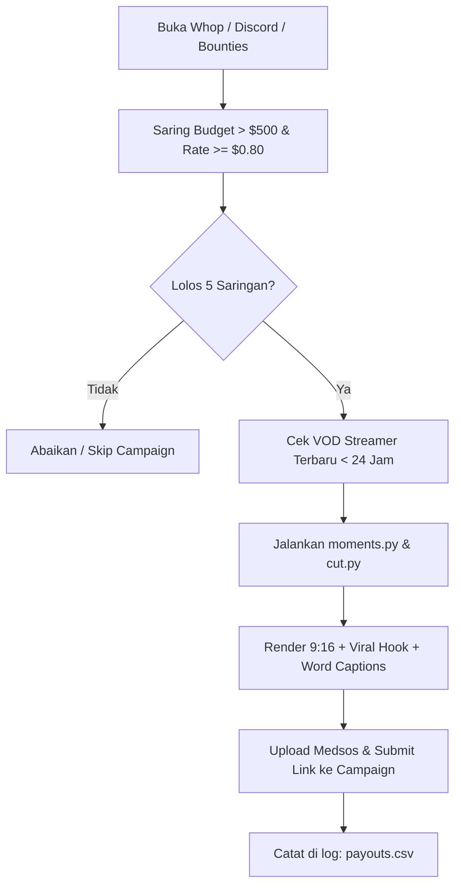

# Checklist Filtrasi Campaign Clipping (Aturan 5 Saringan)

Panduan standar operasional untuk memilah dan memilih campaign clipping (*Whop Content Rewards, Creator Bounties, Discord Rewards*) agar tidak membuang waktu pada campaign yang zonk, budget habis, atau syarat payout tidak masuk akal.

---

## 🎯 Aturan 5 Saringan (5-Filter Rule)

Gunakan tabel matriks evaluasi cepat ini sebelum mulai mengunduh video atau memotong klip:

| Parameter Saringan | ✅ Kategori HIJAU (Ambil) | ⚠️ Kategori KUNING (Waspada) | ❌ Kategori MERAH (Skip/Tinggalkan) |
| :--- | :--- | :--- | :--- |
| **1. Remaining Budget** | Sisa budget > **$1,000** | Sisa $300 – $1,000 | Sisa < **$200** atau sudah 90%+ tersedot |
| **2. Rate per 1K Views (RPM)** | **$0.80 – $2.50+** / 1K views | $0.40 – $0.70 / 1K views | < **$0.30** / 1K views |
| **3. Minimum Views Threshold** | $\le$ **1,000 views** sudah dihitung | 2,000 – 5,000 views | Wajib **> 20,000+ views** baru dihitung |
| **4. Max Cap per Video / Akun** | Max **$50 – $300** per video | Max $20 – $40 per video | Tidak ada cap (rentan budget jebol instan) |
| **5. Supported Platforms** | Mendukung **TikTok, Reels, & Shorts** | Hanya 2 platform | Hanya 1 platform tertentu |

---

## 📋 Breakdown Detail 5 Parameter

### Saringan 1: Remaining Budget (Sisa Alokasi Dana)
- **Tujuan:** Menghindari fenomena *budget depletion* (kamu upload video dan butuh 12–24 jam untuk viral, tapi saat view naik, budget campaign sudah habis $0).
- **Aturan Aksi:**
  - Utamakan campaign baru rilis (< 48 jam) atau campaign dengan saldo tersisa $\ge \$1,000$.
  - Jika sisa budget < $200, **JANGAN** buat klip baru. Kecuali videomu sudah siap posting dalam 10 menit.

### Saringan 2: Rate per 1K Views (RPM / Pembayaran per Seribu View)
- **Tujuan:** Efisiensi waktu dan ROI tenaga.
- **Standar Industri Gaming/GTA VI:**
  - **Tier S (Sangat Bagus):** $\ge \$1.50$ per 1K views.
  - **Tier A (Standar Normal):** $\$0.80 - \$1.20$ per 1K views.
  - **Tier C (Rendah):** Di bawah $\$0.40$ per 1K views (hanya ambil jika streamer tersebut views-nya gampang meledak 100K+).

### Saringan 3: Minimum Views Threshold (Batas Bawah Pembayaran)
- **Tujuan:** Menjamin video dengan performa wajar (1K – 5K views) tetap menghasilkan uang receh yang terakumulasi.
- **Waspadai:** Ada campaign yang mencantumkan syarat *"Hanya membayar jika video mencapai 50K views"*. Ini jebakan untuk menjaring video gratisan dari para clipper pemula.

### Saringan 4: Payout Cap & Batas Pengiriman
- **Maksimal per Video:** Cari tahu batas maksimal reward untuk 1 video (misal: *Cap $100 per video*). Ini melindungi reward pool agar tidak dihabiskan oleh 1 video mega-viral dari clipper lain.
- **Limit Submit:** Periksa apakah ada batas submit harian (misal max 3 video/hari/creator) untuk mengatur kuota upload akun medsosmu.

### Saringan 5: Multi-Platform Compatibility
- Campaign terbaik membolehkan submit dari link **TikTok, Instagram Reels, dan YouTube Shorts**.
- Algoritma tiap platform tidak bisa ditebak; 1 klip yang sepi di TikTok bisa saja meledak ratusan ribu views di YouTube Shorts atau Reels.

---

## 🚨 Daftar Red Flags (Langsung Lewati!)

Tinggalkan campaign jika menemukan salah satu dari tanda bahaya ini:
1. **Aturan Tag Terlalu Ekstrem:** Mewajibkan pin komentar afiliasi, link di bio khusus, dan 5 hashtag aneh yang membunuh jangkauan algoritma organik.
2. **Review Manual Tanpa Batas Waktu:** Status verifikasi video menggantung berhari-hari tanpa kepastian persetujuan.
3. **Klaim Copyright Aktif:** Streamer/pemilik campaign menaruh Content ID di TikTok/YouTube yang memicu strike/mute audio.
4. **Perubahan Rules Sepihak:** Rate diturunkan di tengah jalan saat campaign sedang berjalan.

---

## 🔄 Workflow Harian Pemantauan Campaign

---

*Dokumen ini merupakan bagian dari SOP operasional ProjectGTA.*
